# GHM Books

An advanced book creator for FiveM. Players write their own books, design their own covers, choose the paper, and hand finished copies to other players. Books open like a real book: a hardcover, a spine and crease, and pages you turn by dragging a corner.


Works with **qbx_core**, **QBCore** and **ESX**, and with **ox_inventory**, **one_inventory**, **tgiann-inventory**, **jaksam_inventory**, **qs-inventory** (and the pro build), **origen_inventory**, **qb-inventory** (and the ps-inventory and lj-inventory forks) and **codem-inventory**. It needs **ox_lib** and **oxmysql**. The interface is React and TypeScript, and the built files are included, so you do not need Node.js to run it.

## Features

- **Real page turning.** Grab a corner and the page folds along a diagonal, shows the back of the sheet, lets you see the page underneath, and casts a shadow. Let go past the middle and it finishes turning. Arrow keys work in the reader.
- **Opens like a book.** The book starts closed on its cover and opens onto a two-page spread with a centre crease, page-stack edges and hardcover boards.
- **Book creator.** Write directly on the pages. Add text (body, heading or quote, left, centre or right), add pictures by link. Reorder pages and blocks.
- **Custom covers.** Design your own cover: pick any colour, a texture (plain, cloth, leather, linen), a frame (line, double, corners), then place text and images by dragging them. Six fonts, including capitals, old print and handwriting.
- **Paper types.** Blank, lined, grid, dotted, old parchment and black paper with light ink.
- **Page fonts.** Print, handwriting, old print or typewriter, for the whole book.
- **Limited editions.** Set a print run ("Copy 3 of 10"). Every copy is numbered on its inside cover and the run cannot be exceeded.
- **Dedication, signatures and inscriptions.** A dedication on the inside cover of every copy, plus per-copy signatures and handwritten inscriptions ("To Sam, with thanks") when an author prints a copy for someone.
- **SD Computers app (optional).** With SD Computers (`sd-computers`, [custom apps docs](https://docs.samueldev.shop/resources/computers/custom-apps)) installed, write, edit, print and delete books from a computer instead of with the blank book item.
- **Books are items with metadata.** Every book is one `book` item that carries its own title, author, cover, page count, copy number and signature. Copies share the same pages, so a book can be handed out freely.
- **Locked or shared.** Books are locked by default so only their author can edit them. An author can open a book to anyone holding a copy, for group stories, guides or notes, and can restore the previous version if someone spoils it.
- **Authors stay in control.** `/mybooks` lists everything a player has written. They can edit without holding a copy, print more copies (using a blank book), or delete the book.
- **Admin tools.** `/adminbooks` opens a separate admin window to browse every book, preview its contents, and delete anything that should not be there.
- **Framework and inventory bridge.** The framework and inventory are detected automatically at start, or set in `config.lua`. Adding another one is a single small file (see [Adding a framework or inventory](#adding-a-framework-or-inventory)).
- **Safe by default.** The server validates every save (sizes, counts, colours, fonts, image formats, links), checks ownership on every edit, and the interface stays hidden until a book is actually opened.

## Screenshots

`ghm-books` runs two ways: **standalone**, with a `blank_book` item and `/mybooks`, or with the **SD Computers app**, where books are written, published and printed at a computer. Both use the same editor, covers and reader.

### Standalone

Players use a `blank_book` from the inventory to write, `/mybooks` to manage their books, and a `book` item to read.

#### Creating a book

Write on the pages themselves. Drag a page edge to turn it. The sidebar sets who can edit the book, whether it shows its author, the cover, paper, text, dedication and print run.

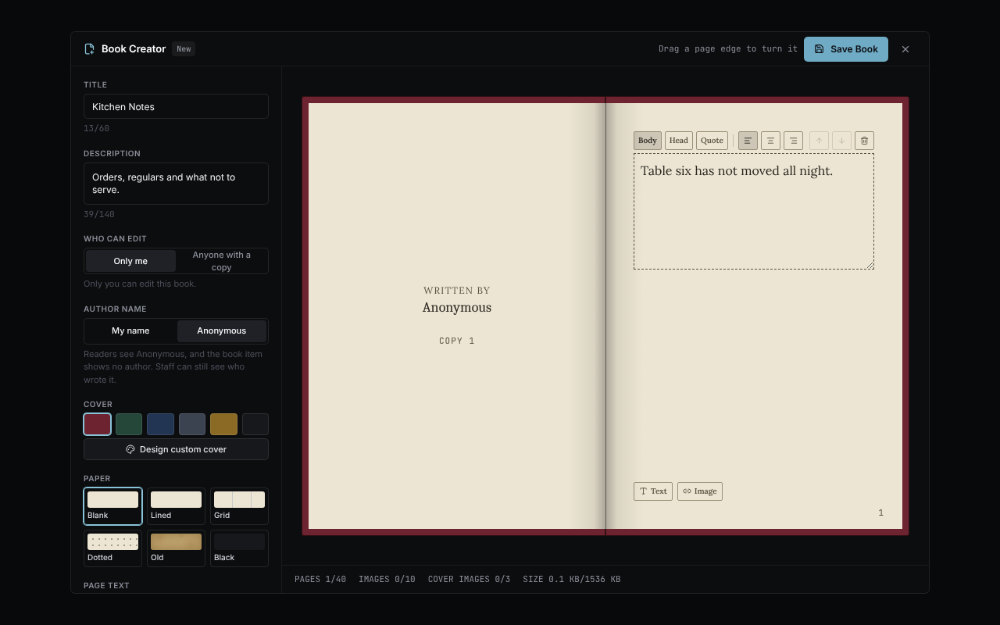

#### Turning a page

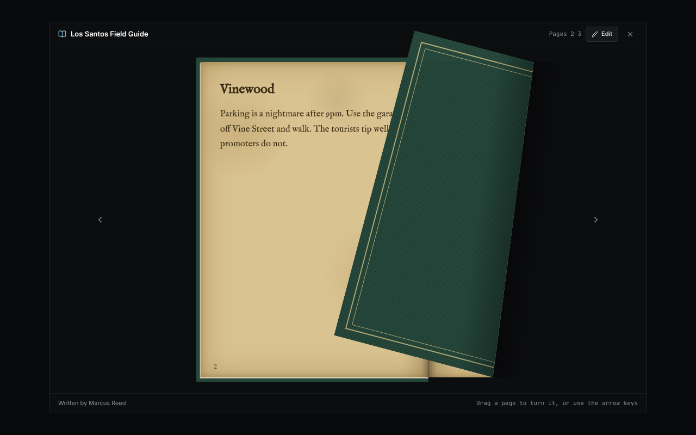

#### Custom covers

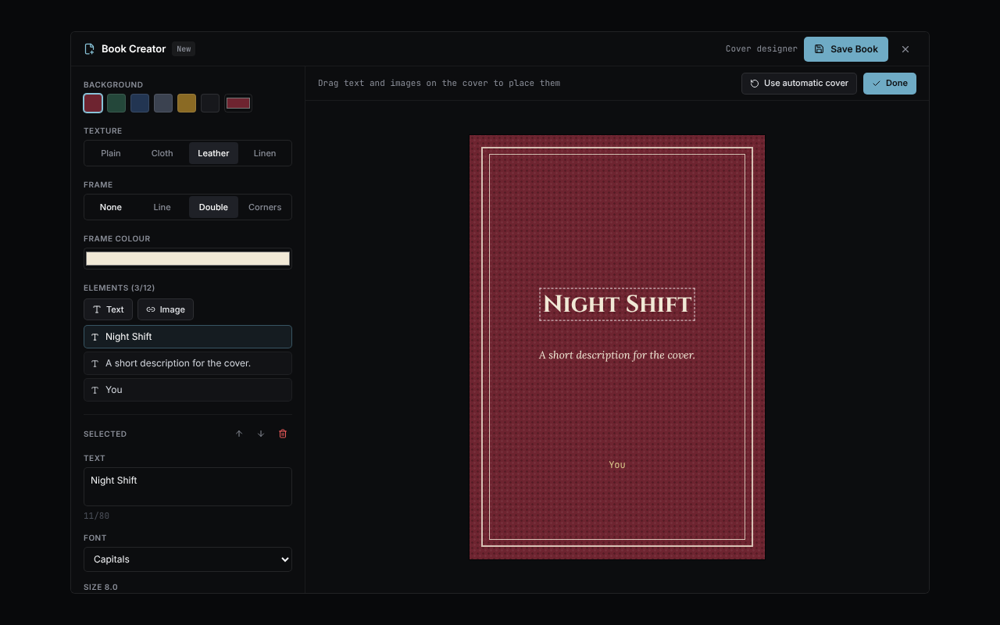

#### Paper types

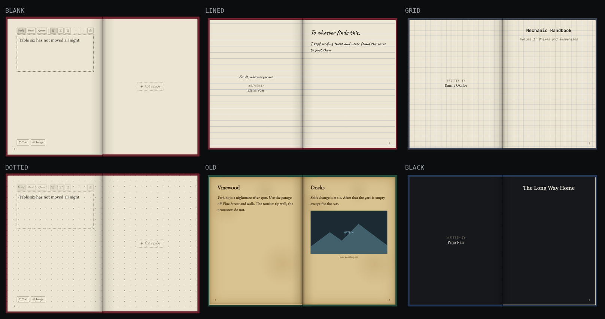

#### Dedication, copy numbers and signatures


#### Handwriting

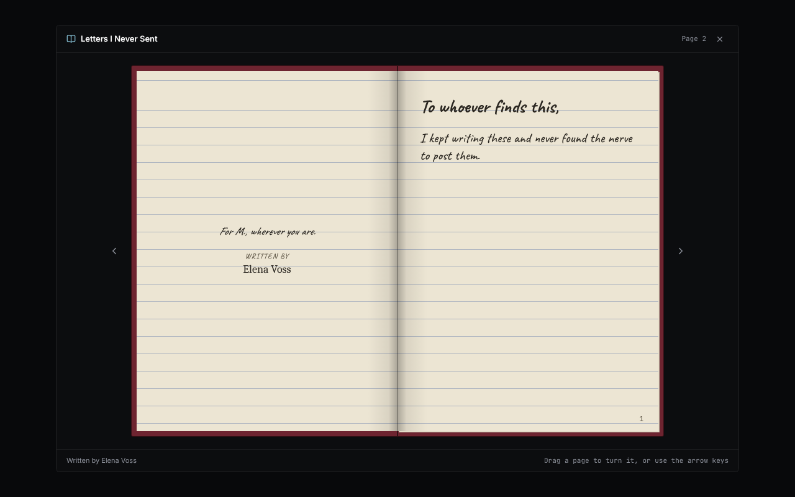

#### Printing a numbered, signed copy

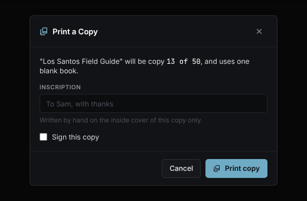

#### Locked and shared books

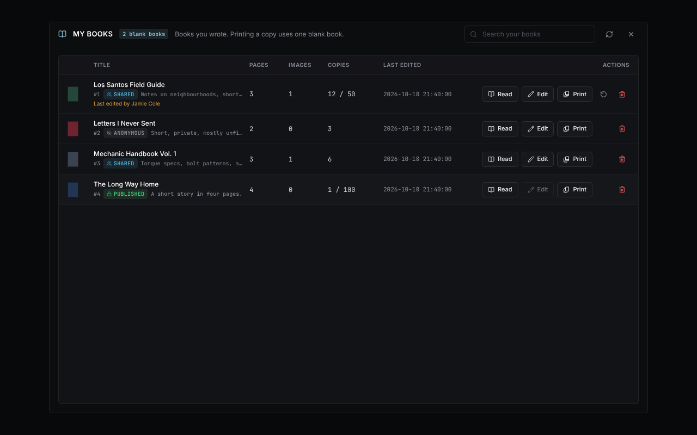

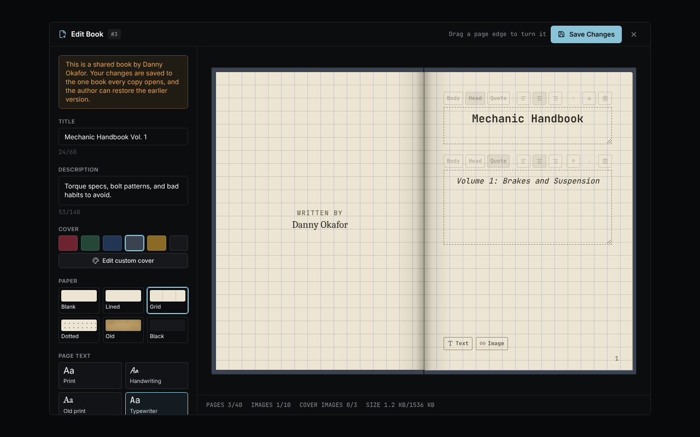

#### Reading

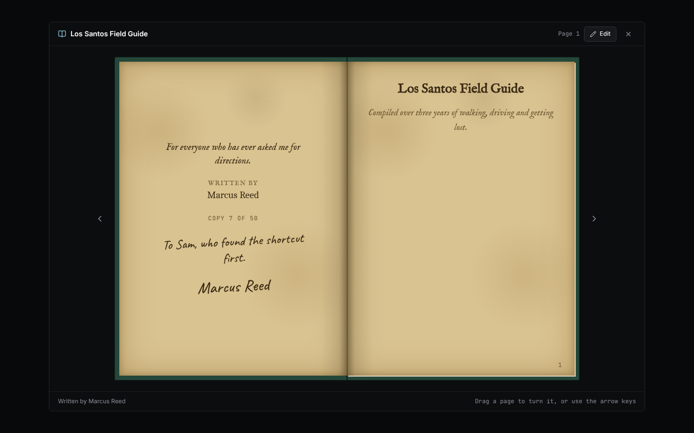

When a `book` item is used, only the book is drawn, over whatever is behind it:

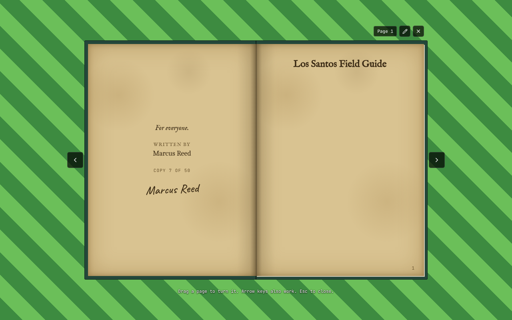

#### My books and admin

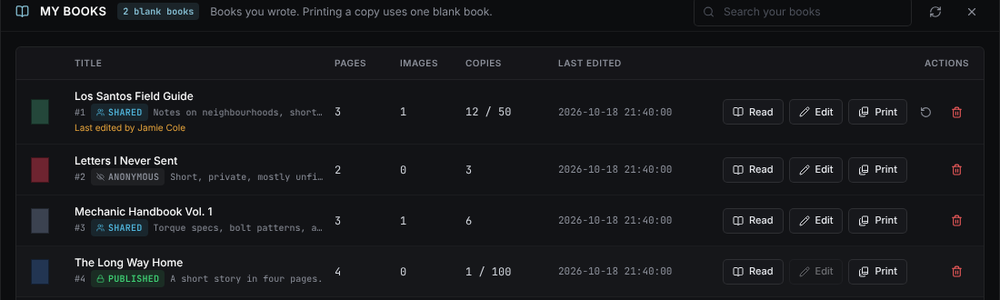

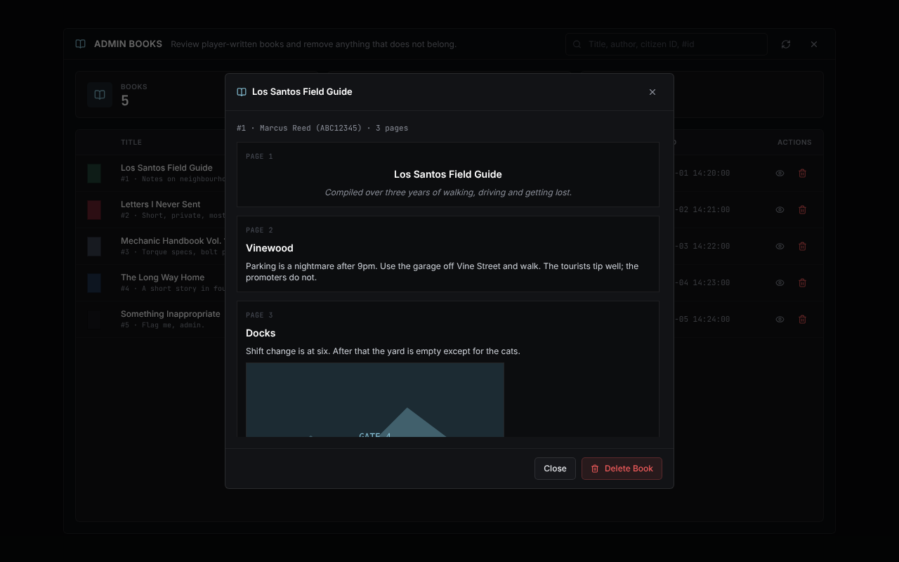

### With SD Computers

The same book creator, as an app on the SD OS desktop. Nothing here needs a blank book to write; copies are printed at a printer.

#### The Books app and your library

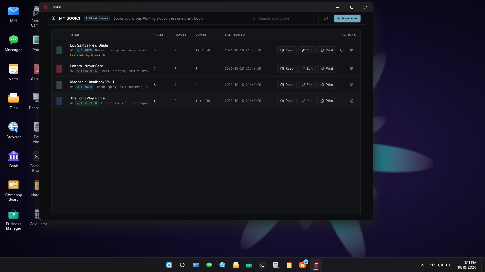

#### Writing and publishing

At a computer the editor also has **Publishing**: a published book is final.

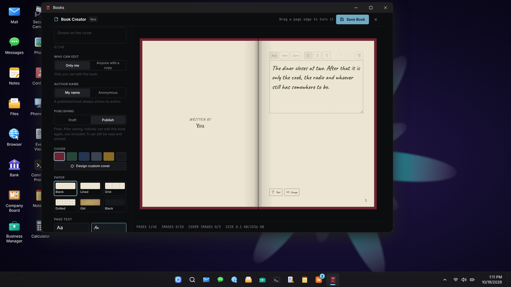

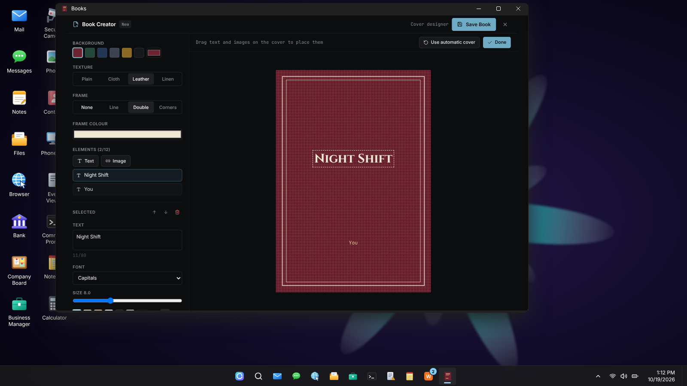

#### Printing at a printer

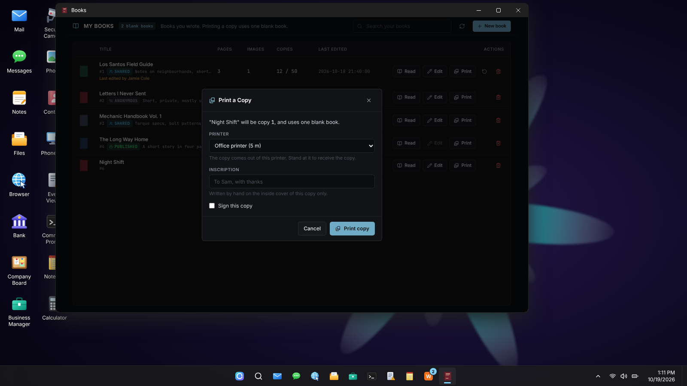

#### Reading

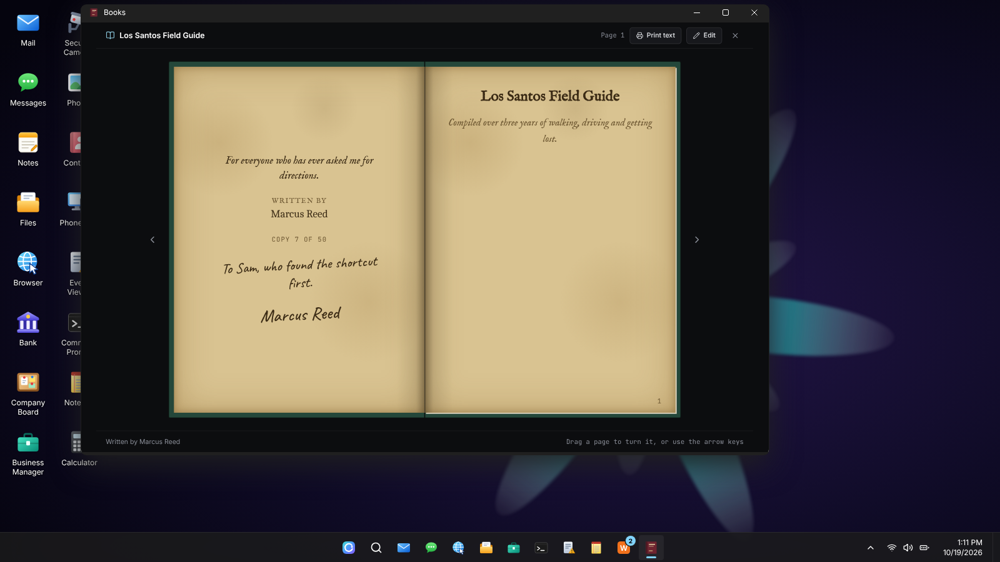

## Requirements

Always required:

| Resource | Why |
| --- | --- |
| [ox_lib](https://github.com/overextended/ox_lib) | Callbacks, commands, notifications |
| [oxmysql](https://github.com/overextended/oxmysql) | Book storage |

One framework (detected automatically):

| Framework | Resource | `Config.Framework` |
| --- | --- | --- |
| Qbox | `qbx_core` | `qbx` |
| QBCore | `qb-core` | `qb` |
| ESX | `es_extended` | `esx` |

One inventory (detected automatically, in this order):

| Inventory | Resource | `Config.Inventory` | Item use | Labels refresh on edit |
| --- | --- | --- | --- | --- |
| One Inventory | `one_inventory` | `one` | framework registry | Yes |
| ox_inventory | `ox_inventory` | `ox` | client export in `items.lua` | Yes |
| tgiann-inventory | `tgiann-inventory` | `tgiann` | framework registry | Yes |
| Jaksam | `jaksam_inventory` | `jaksam` | framework registry | Yes |
| Quasar | `qs-inventory-pro`, `qs-inventory` | `qs` | own hook (pro) / framework registry | Yes |
| Origen | `origen_inventory` | `origen` | own hook | Yes |
| QB | `qb-inventory`, `ps-inventory`, `lj-inventory` | `qb` | framework registry | Yes |
| Codem | `codem-inventory` | `codem` | framework registry | Yes |

The inventory must support **item metadata**. ESX's old default inventory does not, so on ESX use ox_inventory or qs-inventory.

### Support status

- **qbx_core + ox_inventory** is the reference setup, written against the source of both resources.
- **Every other adapter** is written against that inventory's public API and checked against simulated exports (item add, remove, count, slot lookup, metadata read and write, and the item-use hook for each). They have not all been tested on live servers. Inventory APIs differ between versions, so if one misbehaves on your server, please open an issue with the console output.
- **Run the built-in self-test** after installing: `/books_bridgetest` (admin only) adds a test book to you, reads its metadata back, updates it and removes it, then prints a pass/fail line per step to the server console. A `[FAIL] read metadata back` means your inventory ignored the metadata on the item, which is the one thing books cannot work without.
- An inventory that cannot change the metadata of a single slot only costs you the automatic label refresh after an edit (the self-test prints `setMetadata unsupported`). The pages inside always show the latest version.

## Installation

1. **Download** this resource and place the folder in your resources directory as `ghm-books`.

2. **Add the items** for your inventory. Ready-made entries are in the [`install`](install) folder:

   | Inventory | File | Goes in |
   | --- | --- | --- |
   | ox_inventory | [`ox_inventory_items.lua`](install/ox_inventory_items.lua) | `ox_inventory/data/items.lua` |
   | qb-inventory, ps-inventory, lj-inventory | [`qb_items.lua`](install/qb_items.lua) | `qb-core/shared/items.lua` |
   | qs-inventory, qs-inventory-pro | [`qs_items.lua`](install/qs_items.lua) | `qs-inventory/shared/items.lua` |
   | tgiann, origen, codem, one_inventory, jaksam | your inventory's own item file | see the note below |

   For ox_inventory the entries look like this (the `client.export` is what opens the book when the item is used):

   ```lua
   ['blank_book'] = {
       label = 'Blank Book',
       weight = 300,
       stack = true,
       close = true,
       description = 'Empty pages waiting to be written in.',
       client = { export = 'ghm-books.useBlankBook' },
   },

   ['book'] = {
       label = 'Book',
       weight = 350,
       stack = false,
       close = true,
       description = 'A book written by a player.',
       client = { export = 'ghm-books.useBook' },
   },
   ```

   The other inventories use their own item format. Most use the qb-style format shown in `qb_items.lua`; define `blank_book` and `book` there with `useable = true`, and `unique = true` (not stackable) for `book` so every copy keeps its own metadata. `ghm-books` registers the use hook itself.

3. **Add the item images.** Copy the files from `install/images/` into your inventory's image folder: the `.webp` files for ox_inventory (`ox_inventory/web/images/`), the `.png` files for qb-inventory and qs-inventory. These are placeholders; swap in your own art if you like.

4. **Start the resource** after your framework and inventory in `server.cfg` (shown for Qbox and ox_inventory; swap in yours):

   ```cfg
   ensure ox_lib
   ensure oxmysql
   ensure qbx_core
   ensure ox_inventory
   ensure ghm-books
   ```

   On start the console prints which framework and inventory were detected, for example `[ghm-books] framework: qbx (qbx_core), inventory: ox (ox_inventory)`.

5. **Database.** The `ghm_books` table is created automatically on first start, and older installs are upgraded in place. [`sql/ghm_books.sql`](sql/ghm_books.sql) is included for reference only.

6. **Admin access.** `/adminbooks` and the test commands are restricted to `group.admin` by default (change `Config.AdminGroup` in `config.lua`). If your server already uses `add_ace group.admin command allow`, nothing else is needed. Otherwise:

   ```cfg
   add_ace group.admin command.adminbooks allow
   ```

7. **Give players blank books.** Sell them in a shop, add them to crafting, or give them with your admin tools. Using a `blank_book` opens the creator.

## How players use it

| Action | How |
| --- | --- |
| Write a book | Use a `blank_book` from the inventory. Fill in the title, write on the pages, choose a cover and paper, press **Save Book**. The blank book is used up and the player receives a `book`. |
| Read a book | Use a `book` item. Only the book is shown, floating over the game with the world visible around it (no panel or background). Drag a page or use the arrow keys. `Esc` closes it. |
| Edit a book | Open **My Books** (`/mybooks`), press **Edit**. Only the author can edit. Changes show up in every copy. |
| Let others edit a book | In the creator, **Who can edit**: **Only me** (the default) or **Anyone with a copy**. Change it later with **Edit**. |
| Edit a shared book | Open a copy of the book and press **Edit**. Your changes are saved to the one book every copy opens. |
| Hide the author | In the creator, **Author name**: **My name** or **Anonymous**. An anonymous book shows "Anonymous" on the cover, inside and to readers, the `book` item carries no author name, and signed copies are off. A published book always shows its author, so Anonymous only applies to drafts and blank-book books. The item never carries a citizen id. This hides the author from players only: the database and the admin window still record who wrote it, so staff can act on a complaint. |
| Publish a book | Only possible in the SD Computers app (see below). In the creator, **Publishing**: **Draft** or **Publish**. A published book is final: nobody can edit it again, the author included. It can still be read and printed. Books written with a blank book can never be published, so they stay editable (journals, notebooks). |
| Undo someone else's edit | **My Books** shows **Last edited by ...** and a restore button on a shared book that someone else changed. Restoring puts back the version from before their edit and keeps the current one, so you can undo the restore. |
| Print another copy | **My Books**, **Print**. Uses one `blank_book` (or whatever `Config.PrintCostItem` is) and numbers the copy. The author can sign it and write an inscription for its new owner. |
| Give a book away | Hand the `book` item to another player like any other item. |

## Commands

| Command | Who | What it does |
| --- | --- | --- |
| `/mybooks` | Everyone | Lists the books your character wrote: read, edit, print, delete. |
| `/adminbooks` | `Config.AdminGroup` | Admin window: list every book, preview, delete. |
| `/books_seed` | `Config.AdminGroup` | Inserts four sample books (different papers and covers) for testing. |
| `/books_unseed` | `Config.AdminGroup` | Removes the sample books. |
| `/books_give <id>` | `Config.AdminGroup` | Gives you a `book` item for an existing book id. |
| `/books_bridgetest` | `Config.AdminGroup` | Checks the detected framework and inventory adapters (adds and removes a test book on you). |

## How it works

- **Content lives in the database, not the item.** Pages and the cover design are stored in `ghm_books`. The `book` item carries only a `bookId` plus display fields (`title`, which ox_inventory also uses as the item's name, `description`, `author`, `cover`, `pageCount`) and what belongs to that one copy (`copy`, `edition`, `signed`, `inscription`). Any copy opens the same book.
- **Labels stay fresh.** Opening a copy refreshes its metadata if the book changed, and saving an edit refreshes the copies held by online players. A copy keeps its own number, signature and inscription through edits.
- **Who may edit is enforced on the server.** A locked book can only be saved by its author. A shared book can be saved by its author or by anyone who holds a copy of it (checked in their inventory). Only the author can change who may edit, the dedication and the print run, and only the author can print, restore or delete.
- **Shared books are protected from accidents.** Every edit by someone other than the author keeps the previous version, so the author can restore it. Each book has a revision number: if two people edit at once, the second save is refused with a message instead of overwriting the first. The last editor's name is stored and shown to the author and in the admin window.
- **Print runs are enforced in the database.** A copy number is claimed with a single conditional update, so two prints at once cannot go past the limit. A failed print gives the number and the blank book back.
- **A page is a list of blocks.** Each block is text (with style and alignment) or an image. Covers are lists of positioned text and image elements.
- **Pictures are links.** FiveM cannot open a file picker, so a picture is added by pasting a direct link, and only from the sites in `Config.ImageHosts` (imgur, discord, fivemanage, ibb, the Qbox CDN, Cloudflare R2 public buckets and more; add your own). The book stores only the link, so it stays small.
- **The server decides.** The interface only sends what the player wants to save. The server clamps and validates everything, checks the player holds a blank book (or owns the book being edited), and enforces the limits below.
- **Deleting is final.** A deleted book's copies stay in inventories but show "the pages have been torn out" when opened.

## Configuration

Everything is in [`config.lua`](config.lua).

```lua
Config.Framework = 'auto' -- 'auto' | 'qbx' | 'qb' | 'esx'
Config.Inventory = 'auto' -- 'auto' | 'ox' | 'one' | 'tgiann' | 'jaksam' | 'qs' | 'origen' | 'qb' | 'codem'

Config.BlankItem = 'blank_book'
Config.BookItem  = 'book'

-- What printing another copy costs: one of this item per copy. nil makes printing free.
Config.PrintCostItem = Config.BlankItem

Config.Limits = {
    maxTitle          = 60,
    maxDescription    = 140,
    maxPages          = 40,
    maxBlocksPerPage  = 8,
    maxTextLength     = 2500,
    maxCaption        = 120,
    maxImages         = 10,          -- images inside pages
    maxImageBytes     = 140 * 1024,  -- per image, after compression
    maxUrlLength      = 500,
    maxBookBytes      = 1536 * 1024, -- whole book, including the cover
    maxCoverElements  = 12,
    maxCoverImages    = 3,
    maxCoverText      = 80,
    maxDedication     = 200,
    maxInscription    = 120,
    maxEdition        = 500,         -- largest print run an author may set
    maxBooksPerAuthor = 50,
}

Config.Covers    = { 'oxblood', 'forest', 'navy', 'slate', 'ochre', 'black' }
Config.Papers    = { 'blank', 'lined', 'grid', 'dotted', 'old', 'black' }
Config.PageFonts = { 'serif', 'hand', 'old', 'mono' }
Config.AdminGroup = 'group.admin'

Config.Computers = {
    enabled = false,
    appId = 'books',
    label = 'Books',
    color = '#6e2430',
    groups = nil,       -- e.g. { author = 0 }: job name = minimum grade
    items = nil,        -- items a player must carry to see the app
    itemCreator = false,    -- false: the blank book no longer opens the creator
    printToPrinter = true,  -- copies come out of an sd-computers printer; false hands the item over at once
    printerRange = 30.0,    -- metres from the player that a printer may stand
    secondsPerCopy = 4,     -- how long each copy takes to come out
    trayLimit = 20,         -- most uncollected copies one player may have waiting at a printer
    reach = 3.0,            -- metres from a printer its tray can be reached
}
```

### Pictures (`Config.ImageHosts`)

Pictures are added to a book by pasting a direct link to the image (right-click an image on Imgur, Discord and so on, and copy its address). A picture added by link is loaded from that website by everyone who opens the book, so the site sees their IP address. `Config.ImageHosts` is the list of websites a book may link pictures from (subdomains included). It starts with the same list sd-computers uses: imgur, fivemanage, discord, ibb.co, postimg.cc, catbox.moe and gyazo. Add your own hosts, or set it to `nil` to allow any `http(s)` link. The editor shows players the allowed sites and does not accept a link from any other. The server checks every link again when the book is saved. To host your own pictures, upload them to one of those sites, or add your own CDN's address to the list (the Qbox CDN, Cloudflare R2 `r2.dev` and Fivemanage are already on it).

Larger limits mean larger database rows and heavier network transfers when a book is opened. If saving large books fails on your server, lower `maxImageBytes` and `maxBookBytes` first.

## SD Computers (optional)

If SD Computers (`sd-computers`, [custom apps docs](https://docs.samueldev.shop/resources/computers/custom-apps)) is installed, `ghm-books` can put a **Books** app on its desktop, and books are written, edited, printed and deleted from a computer instead of with the blank book item. Nothing changes if you leave it off.


**Turn it on**

1. Install and start `sd-computers` (version 1.1.0 or newer has custom apps; 1.2.0 or newer also shows the app on the prop's live screen).
2. In `ghm-books/config.lua` set `Config.Computers.enabled = true`.
3. Start `ghm-books` (before or after `sd-computers`). The console prints `SD Computers: "Books" app registered (on every computer)`. If `sd-computers` restarts later, the app is registered again automatically.
4. By default the app is on **every** computer. To keep it to some computers, see [Choosing which computers get the app](#choosing-which-computers-get-the-app).

**What changes when it is on**

- The **Books** app opens on the author's library: **New book**, **Read**, **Edit**, **Print**, **Delete**. The editor is the same page-turning editor; the window can be resized and the book scales to fit.
- **No blank book is needed to write.** A book is saved to the author's library with no copies, and the print dialog opens straight away so you can make the first copies.
- **Copies come out of a printer.** **Print** lets you pick an sd-computers printer in range of the computer. The copy is numbered and paid for (`Config.PrintCostItem`, a blank book by default, or `nil` for free) at once, and you collect the `book` item standing at that printer: you collect the `book` item by standing at that printer (within about two metres): the player is told when printing starts ("Wait at the printer"), and once the copies are out they are handed over automatically with a notification. They do not have to be there the whole time: copies stay in the queue (it survives restarts) and are handed over whenever the player next stands at that printer, so there is no second option next to sd-computers' own "Take printouts". (sd-computers gives other resources no way to add to its option, so books are not part of that menu.) Copies can be signed and inscribed, exactly as without computers. If the server has no sd-computers printers at all, the copy is handed over immediately.
- With `itemCreator = false` (the default), using a blank book no longer opens the creator and `/mybooks` points players to the computer. Set `itemCreator = true` to allow both ways.
- **Publishing is final.** Set **Publishing** to **Publish** in the creator and the book can never be edited again by anyone (the server refuses every later edit, including from the reader and from a computer). A published book shows a **Published** badge, the Edit button is disabled, and an edition's text and print run are fixed. Copies can still be printed up to the limit. Books written with a blank book cannot be published, so a journal can keep growing. An admin can still delete a book.
- **Live screen.** sd-computers 1.2.0 and later also draw custom apps on the live screen of the computer's prop, so players nearby see the book being written, as with its built-in apps. Set `Config.Computers.mirror = false` to hide the Books window from onlookers (the screen shows the app's icon and name instead). The window's own pictures and fonts are drawn; pictures linked from other sites are not, on the prop's screen.
- **Print text** in the reader sends the book's text to a printer in the room through sd-computers' own printing, so it comes out as a printed page.
- Limit the app to certain computers, jobs or item holders: see [Choosing which computers get the app](#choosing-which-computers-get-the-app). sd-computers runs the app's server code only for a player signed in at a computer that has the app, and rate-limits it.
- A character may have written at most `Config.Limits.maxBooksPerAuthor` books (50 by default), since writing at a computer costs nothing.

### Choosing which computers get the app

sd-computers shows a third-party app on **every** computer, and the `apps` list on a computer in `configs/shared/computers.lua` does not control third-party apps. The app is limited with options that `ghm-books` passes to `AddCustomApp`, all in `Config.Computers`:

| Option | What it limits | Example |
| --- | --- | --- |
| `computers` | The app shows only on the computers whose id is in the list. | `computers = { 'public_pc', 'placed_3' }` |
| `styles` | Only on computers with one of these looks (`modern`, `retro`, `mac`, or any style your sd-computers defines). | `styles = { 'modern' }` |
| `groups` | Only for players with the job or gang, at this grade or higher. | `groups = { author = 0 }` |
| `items` | Only for players carrying one of these items. | `items = { 'library_card' }` |

`computers` and `styles` are lists of strings, not `{ id = true }` tables. Leave an option at `nil` to not limit by it. When you use several, all of them must allow the player.

**Finding a computer's id**

- A computer you listed in sd-computers' `configs/shared/computers.lua` has an `id` field (for example `id = 'public_pc'`). Use that id.
- A computer you placed from the `/computeradmin` panel is `placed_<number>` (the number is its `id` in sd-computers' `computers_placed` database table, so a computer with id 3 is `placed_3`).
- A computer defined by a prop `model` is one entry with one id, shared by every prop of that model in the world. You can allow or block all of them, not one prop.

**Example: only a library and the town hall**

```lua
Config.Computers = {
    enabled = true,
    -- ...
    computers = { 'library_pc', 'townhall_desk' },
}
```

After editing, restart `ghm-books`. The console line tells you what it did, for example `app registered (computers: library_pc, townhall_desk)`. A computer that is not in the list does not show the Books icon at all. If you list ids that do not exist, the app simply appears nowhere; a typo is the usual cause of an app that never shows up.

**Example: only for a job, on any computer**

```lua
groups = { librarian = 0 },
```

Players with another job do not see the app, wherever they sit. This is how to give a company its own publishing desk; combine it with `computers` to also tie it to one place.

**Why a queue of our own.** sd-computers' printers only hand out its own printed-page item, and its tray cannot be extended. So books use its printers as places: a print job is stored in `ghm_book_prints` and collected at the printer's position (checked on the server). Jobs survive restarts, only the author can collect them, and a job for a book that was deleted meanwhile is discarded. Each player may have `Config.Computers.trayLimit` copies waiting at one printer.

**How it works.** The app is this resource's own page (`web/dist/index.html`), framed by the desktop. It calls server endpoints registered with `exports['sd-computers']:AddCustomApp`, and those endpoints run the same handlers as the in-game menus, so the rules (ownership, limits, validation, print runs) are identical. Nothing in `ghm-books` depends on `sd-computers`; with it absent or disabled, none of this code runs.

**Preview in a browser.** `cd web && npm run dev`, then open the printed address followed by `#computer` (for example `http://localhost:5173/#computer`) to see the app as it looks in a computer window, with mock data.

## Adding a framework or inventory

Everything that touches your framework or inventory lives in [`server/bridge`](server/bridge). The rest of the script only talks to the bridge.

- A **framework** adapter (`server/bridge/framework/<name>.lua`) answers one question, `identity(src)`, returning `{ citizenid, name }` for the player's current character.
- An **inventory** adapter (`server/bridge/inventory/<name>.lua`) implements `getItems`, `getSlot`, `count`, `canCarry`, `remove`, `add` and `setMetadata`, and, if the inventory cannot call a client export when an item is used, `registerUsable`. Slots are normalised to `{ slot, name, count, metadata }`.

Copy the closest existing adapter, register it with `Bridge.registerFramework` or `Bridge.registerInventory`, add the file to `fxmanifest.lua`, and add its name to the detection order in `server/bridge/init.lua`. Pull requests for more inventories (for example core_inventory) are welcome. Add a case for your inventory to `/books_bridgetest` coverage by running it once and pasting the output into the pull request.

## Trying it without a server

The interface runs in a normal browser with mock data, so you can design and test without starting FiveM:

```bash
cd web
npm install
npm run dev
```

Open the printed address. A launcher lets you open the creator, the reader with sample books, `/mybooks` and the admin window. Nothing is saved.

## Building the interface

The compiled interface is in `web/dist` and is committed. To change it:

```bash
cd web
npm install
npm run build
```

Source is in `web/src`. The page-turn is `components/FlipBook.tsx`, the cover renderer is `components/CoverRender.tsx` and the cover designer is `components/CoverDesigner.tsx`.

## Troubleshooting

- **The interface is stuck on screen.** It should never show on join: the page is transparent and renders nothing until a book is opened, and the client resets focus on start and character load. If you ever see it, restart `ghm-books` and report the steps.
- **"You need a blank book".** Publishing and printing consume one `blank_book`. Check the item exists in your inventory's item list and that the player holds it.
- **The console says no framework or inventory was found.** Start `ghm-books` after them, or set `Config.Framework` / `Config.Inventory` explicitly. Detection waits up to 30 seconds for them to start.
- **Using the book item does nothing (not ox_inventory).** Make sure the items are defined as `useable` and that `ghm-books` started after the inventory so it could register the use hook.
- **Fonts look different.** Cover fonts (Cinzel, IM Fell English, Caveat) load from Google Fonts. Players without internet fall back to system fonts. To host them yourself, add the files to `web/` and change the `@font-face` / `<link>` in `web/index.html`.
- **A picture link is refused.** It must be a direct link to the image (ending in `.png`, `.jpg`, `.webp`, `.gif` or similar, not a web page that shows it) from a site in `Config.ImageHosts`, and at most `maxUrlLength` characters. The editor lists the allowed sites.
- **"No printer is in range of this computer".** Copies print at an sd-computers printer within `Config.Computers.printerRange` metres of you. Place printers with sd-computers' admin panel (`/computeradmin`), or set `printToPrinter = false`.
- **Printed books are not handed over.** Stand within about two metres of the printer you chose and wait for the print time (`secondsPerCopy` per copy in the queue). They are collected automatically once out. If your inventory is full you are told, and they are handed over when you step away and back with room.
- **The Books app is missing from the desktop.** Check `Config.Computers.enabled`, that `sd-computers` is started and is version 1.1.0 or newer, that your job or items meet `groups` / `items`, and that `sd-computers`'s own `configs/shared/apps.lua` has `Enabled = true` and does not block the id `books`.
- **`/adminbooks` says nothing happens.** The player needs the `command.adminbooks` ace (see Installation, step 6).

## Contributing

Issues and pull requests are welcome. Please keep the interface free of `backdrop-filter` (FiveM's embedded browser does not support it) and run `npx tsc --noEmit` in `web/` before sending a change.

## License

[MIT](LICENSE)
